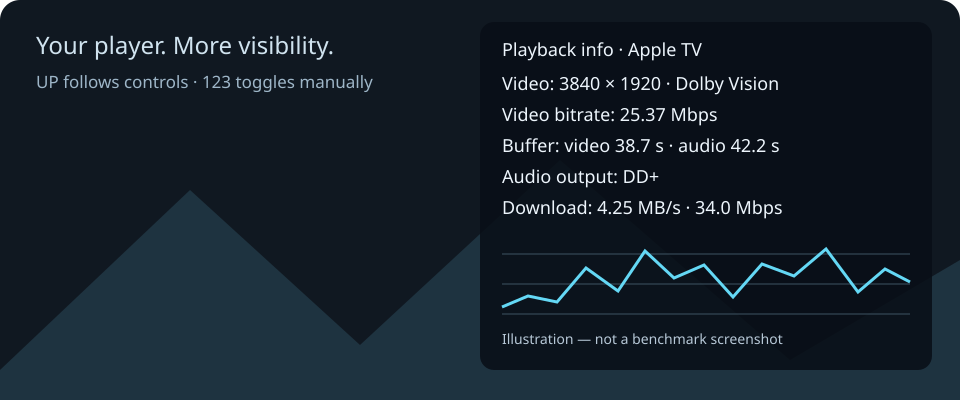

# Apple TV Quality Patch

English | [简体中文](README.zh-CN.md)

**Choose the highest available variant. See what the player is doing.**

A local patcher and diagnostic HUD for **Apple TV on Android TV 14.3.1 (143100)**. Public preview **v0.2.0**: narrowly supported, version-pinned, and designed to fail safely on unknown input.



- Highest-resolution/bitrate selection with seamless restoration after trickplay.
- One-ahead video prefetch, paused high-water filling, and optional video-only memory budgets.
- **UP** shows diagnostics only on the active playback page and follows native controls. **123** toggles a manual HUD. Original navigation and held seeking are retained.
- Separate forward video/audio buffers, declared bitrate, dynamic range, and network history; bounded local logs for later analysis.

## Start here

1. Read [compatibility and installation implications](docs/compatibility.md).
2. Follow the [build/install guide](docs/quickstart.md): `doctor` → `inspect` → `patch` / `hud` → explicit device installation.
3. Review [privacy and permissions](docs/privacy.md), [troubleshooting](docs/troubleshooting.md), and [rollback](docs/quickstart.md#logs-and-rollback).

```sh
python3 -m atvpatch doctor
python3 -m atvpatch inspect --input input
# After creating your own key and setting ATV_KEYSTORE_PASSWORD:
python3 -m atvpatch patch --input input --output build/apks --keystore keys/local.p12
python3 -m atvpatch hud --output build/hud --keystore keys/local.p12
```

Doctor and inspect are read-only. Supply your own original APK set and signing key. **A locally signed patch cannot update the official app in place.** First migration normally requires manually uninstalling and signing in again, clearing app data. No command automatically uninstalls the app. See the guide before migrating.

## What is verified?

| Area | Evidence / limit |
|---|---|
| Target app | 14.3.1 / 143100 **and exact original asset hashes** |
| Tested device | Sony X75J, Android 12, armeabi-v7a; other devices unverified |
| Quality | Selected titles around 25 Mbps in 4K Dolby Vision; manifests differ |
| Buffer example | One 60-second pause/resume check reached 43 s paused and 31–42 s playing with an explicit 128-MiB video profile |
| Remote | Physical UP/navigation and held seeking confirmed by the user on the tested TV |
| v0.2.0 preparation | Refactored output matches v0.1.4 bytes across eight parameter combinations; packaging/environment tooling does not establish new device support |

The figure is an illustration. Measurements are single-device examples, not universal speedups or long-term stability guarantees. Download speed is total TV traffic, not video bitrate; DD+ alone does not confirm Atmos. [Full validation record](docs/validation.md).

## Distribution

Source releases contain original tools, HUD source, documentation, and hashes. **No Apple APKs, extracted bundles, credentials, media, or signing keys are distributed.** A maintainer-signed HUD may be attached separately after release-key setup; CI smoke-build keys are disposable and not release identities. [Release process](docs/releasing.md).

Original project code: [MIT](LICENSE). Vendor rights and trademarks: [NOTICE](NOTICE). This independent project does not unlock content, subscriptions, or DRM.

## Contribute

[Contribution guide](CONTRIBUTING.md) · [Report sensitive issues](SECURITY.md) · [Architecture](docs/architecture.md) · [Version adapter guide](docs/adapting.md) · [Changelog](CHANGELOG.md)

Do not attach vendor APKs, signing keys, account data, subscription URLs, or unreviewed raw logs to an issue. Device reports distinguish automated checks, device measurements, and physical-remote confirmation.
