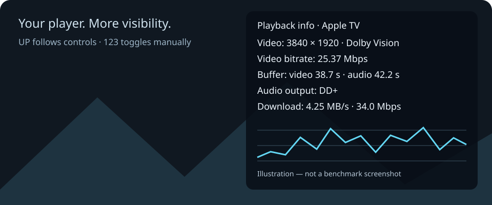

# Apple TV Quality Patch

[](https://github.com/orange-the-weak/apple-tv-quality-patch/actions/workflows/test.yml)

[English](README.md) | 简体中文

**选择片源提供的最高档位，看清播放器的实际状态。**

面向 **Apple TV Android TV 14.3.1（143100）** 的本地补丁工具与诊断浮窗。**v0.2.0 公开测试版**，只支持明确验证的版本与资产哈希，未知输入会停止处理。



- 选择最高分辨率／码率，快进结束后以无缝方式恢复目标档。
- 下一视频片段预取、暂停高水位补缓冲、可选视频内存预算。
- **上键**仅在活动播放页随原生控制栏显示／隐藏；**123**手动开关。保留原导航和方向键长按。
- 分别显示音视频前向缓冲、声明码率、动态范围和网速历史；有界日志供日后分析。

## 从这里开始

1. 阅读[兼容范围与安装影响](docs/compatibility.zh-CN.md)。
2. 按[构建与安装指南](docs/quickstart.zh-CN.md)执行：环境检查 → 原包检查 → 本地构建 → 单独安装。
3. 查看[隐私与权限](docs/privacy.zh-CN.md)、[排障](docs/troubleshooting.zh-CN.md)和[回退](docs/quickstart.zh-CN.md#日志与回退)。

```sh
python3 -m atvpatch doctor
python3 -m atvpatch inspect --input input
# 创建自己的密钥，并设置 ATV_KEYSTORE_PASSWORD 后：
python3 -m atvpatch patch --input input --output build/apks --keystore keys/local.p12
python3 -m atvpatch hud --output build/hud --keystore keys/local.p12
```

预检均为只读。原包与签名密钥由用户本地提供。**本地签名不能直接覆盖官方版**；首次迁移通常需要自行卸载并重新登录，会清除数据。本工具不自动卸载，请先阅读指南。

## 已验证什么？

| 项目 | 证据与边界 |
|---|---|
| 应用 | 14.3.1／143100，且原始资产哈希完全匹配 |
| 设备 | Sony X75J、Android 12、armeabi-v7a；其他设备未验证 |
| 画质 | 部分片源约25Mbps、4K杜比视界；不同清单的最高档不同 |
| 缓冲示例 | 一次60秒暂停／恢复比较，显式128MiB配置下暂停约43秒、播放约31–42秒 |
| 遥控器 | 用户在实体电视确认上键／导航及长按恢复 |
| 本轮发布准备 | 重构后八种参数组合与0.1.4脚本逐字节一致；工具工程化不等于新增设备验证 |

图片为示意图，数据是单设备短测，不代表普遍提升或长期稳定保证。下载速度是电视总流量，不等于视频码率；DD+不单独证明Atmos。详见[验证记录](docs/validation.zh-CN.md)。

## 发布边界

源码包只收录原创工具、浮窗源码、文档和校验清单，**不收录Apple APK、提取脚本、凭据、媒体或签名私钥**。配置正式发布密钥后可单独附带自有HUD APK；CI临时测试密钥不作为正式签名身份。[发布流程](docs/releasing.zh-CN.md)。

原创代码使用[MIT](LICENSE)，厂商权利和商标见[NOTICE](NOTICE)。项目独立维护，不解锁内容、订阅或DRM。

## 参与

[贡献指南](CONTRIBUTING.zh-CN.md) · [敏感问题报告](SECURITY.zh-CN.md) · [架构](docs/architecture.zh-CN.md) · [版本适配](docs/adapting.zh-CN.md) · [更新记录](CHANGELOG.zh-CN.md)

Issue请勿附原APK、密钥、账号、订阅地址或未经检查的原始日志。反馈时区分自动测试、实机测量与实体遥控器确认。
